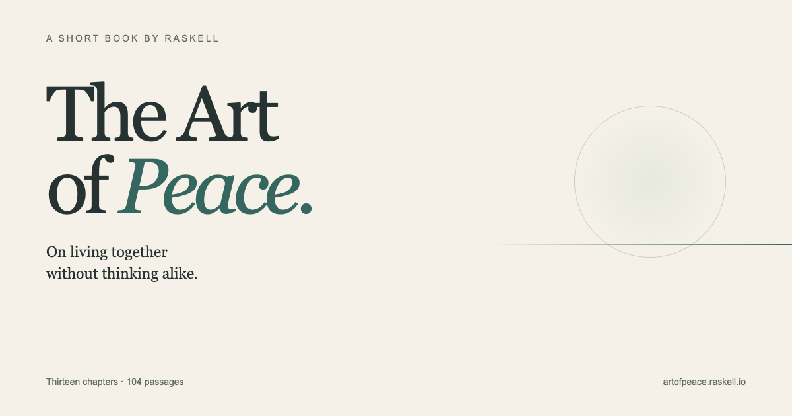

# The Art of Peace

**On living together without thinking alike.**

A short book by [Raffael Schneider](https://raskell.io/about/), conceived during a morning swim in Nago Bay, Okinawa. Thirteen chapters explore peace among people who remain free to disagree: independent thought, voluntary cooperation, strength with humility, clear boundaries, and room for outliers.

[Read in English](https://artofpeace.raskell.io) · [한국어](https://artofpeace.raskell.io/ko/) · [简体中文](https://artofpeace.raskell.io/zh/) · [Read the manuscript](manuscript.md) · [About the book](https://artofpeace.raskell.io/about/)



## The book

Raskell is Raffael Schneider’s tech and development blog and web presence. The book is published under his own name.

An opening, thirteen chapters, 104 numbered passages, and a closing. The literary influences are Sun Tzu’s *The Art of War* and Kahlil Gibran’s *The Prophet*. The prose is original and was drafted with AI assistance from Raffael’s ideas and experiences.

Peace here leaves room for disagreement. It asks how people can share a world without being required to share every thought or value.

1. On peace
2. On difference
3. On boundaries
4. On strength
5. On understanding
6. On sharing
7. On trust
8. On diplomacy
9. On escalation
10. On humility
11. On what we build
12. On repair
13. On keeping peace

## The web edition

The Shoreline cover pairs a still sun with gently moving water. Each chapter has a monochrome illustration. Readers can choose a continuous edition or individual chapters, adjust type size, switch to night colours, and optionally remember their place.

The visual reading panel offers type-size previews, illustrated Paper / Night / Device choices, and motion and reading-position switches. A language menu keeps the current chapter and passage when switching editions.

The complete text and navigation work without JavaScript. Motion respects the device’s reduced-motion setting and the reader’s preference. An SVG shoreline replaces the WebGL water when needed. Print styles, a Markdown download, stable passage links, and machine-readable discovery files are included.

Each reading page has its own description. Open Graph and Twitter cards include image descriptions, and Book structured data identifies the author and subjects. Edit page summaries in `config.toml` under `extra.page_descriptions`; the generator carries them into the page metadata.

## Run locally

Install [mise](https://mise.jdx.dev), then run:

```sh
mise install
mise run serve
```

Open **http://127.0.0.1:1118**. Changes to the manuscript regenerate the book and reload the preview. Set `BOOK_PORT` to choose another port.

| Command | Purpose |
| --- | --- |
| `mise run serve` | Live local preview |
| `mise run build` | Generate the static site in `public/` |
| `mise run check` | Build and verify text, links, anchors, and metadata |
| `mise run proposals` | View the design studies on port 1119 |

Zola **0.22.1** and Python **3.12.13** are pinned in `mise.toml`. Python uses only its standard library. The site has no npm dependencies, external fonts, analytics, or application server.

## Edit the source

`manuscript.md` is the English source. The full Korean and Simplified Chinese translations live in `translations/manuscript.ko.md` and `translations/manuscript.zh.md`. These translations were prepared with AI assistance and remain open to revision. Keep all fifteen sections and the 104 passage numbers aligned when revising any edition. Edit it, then run `mise run check`. The checks compare all 104 passages in both reading views against each language’s manuscript and validate local links, anchors, metadata, and discovery files.

| Path | Purpose |
| --- | --- |
| `manuscript.md` | Book text and reading order |
| `translations/ui.<lang>.json` | Navigation, reading controls, and page text in English, Korean, and Simplified Chinese |
| `translations/manuscript.<lang>.md` | Translated book manuscripts with shared passage numbering |
| `scripts/prepare.py` | Generate chapter pages, book data, and machine copies |
| `templates/` | Book-specific cover, About page, and illustrations |
| `themes/shore/` | Reading layout, water, motion, controls, and print styles |
| `sass/brand.scss` | Raskell branding |
| `config.toml` | Identity, canonical URL, navigation, and footer |
| `scripts/check.py` | Content and site checks |
| `scripts/social.html` | Source for the social card |
| `design/` | Visual proposals and design history |

Generated `content/`, `data/book*.json`, machine copies (including `static/ko/` and `static/zh/`), and `public/` are ignored by Git. Do not edit them by hand. Keep passage identifiers stable when revising: `/on-boundaries/#p5` and `/read/#iii-5` refer to the same passage. The same identifiers apply below `/ko/` and `/zh/`. Each edition has its own Markdown download, machine-readable text, metadata, and social card. Language alternates appear in page heads and the sitemap; translation schema links back to the English book.

UI catalogues must have identical keys. Chinese paragraphs stay on one line; Korean uses formal prose and word-aware wrapping. Preview `scripts/social.html?lang=ko` or `?lang=zh` at 1200 × 630 to regenerate the corresponding `static/social.<lang>.png` after a cover change.

## Publish

The site runs on **Cloudflare Pages**, connected to this repository. Pushes to `main` build and deploy production; pull requests run the same content checks in GitHub Actions.

| Cloudflare setting | Value |
| --- | --- |
| Production branch | `main` |
| Framework preset | None |
| Build command | `bash scripts/cf-pages-build.sh` |
| Build output directory | `public` |
| Custom domain | `artofpeace.raskell.io` |

The build script uses mise and the pinned tools to run `mise run check` before Cloudflare publishes the output. No deployment credentials are stored in this repository.

The first web edition retains the manuscript’s 104 passage references. EPUB and a separately typeset PDF may follow; the current edition offers Markdown and browser printing.

## Licence

The text of the book is © 2026 Raffael Schneider, licensed [CC BY-NC-ND 4.0](https://creativecommons.org/licenses/by-nc-nd/4.0/): share it unchanged, with credit, for non-commercial purposes. See [LICENSE.md](LICENSE.md). The licence covers the text only, not the code, design, or illustrations of the web edition.
